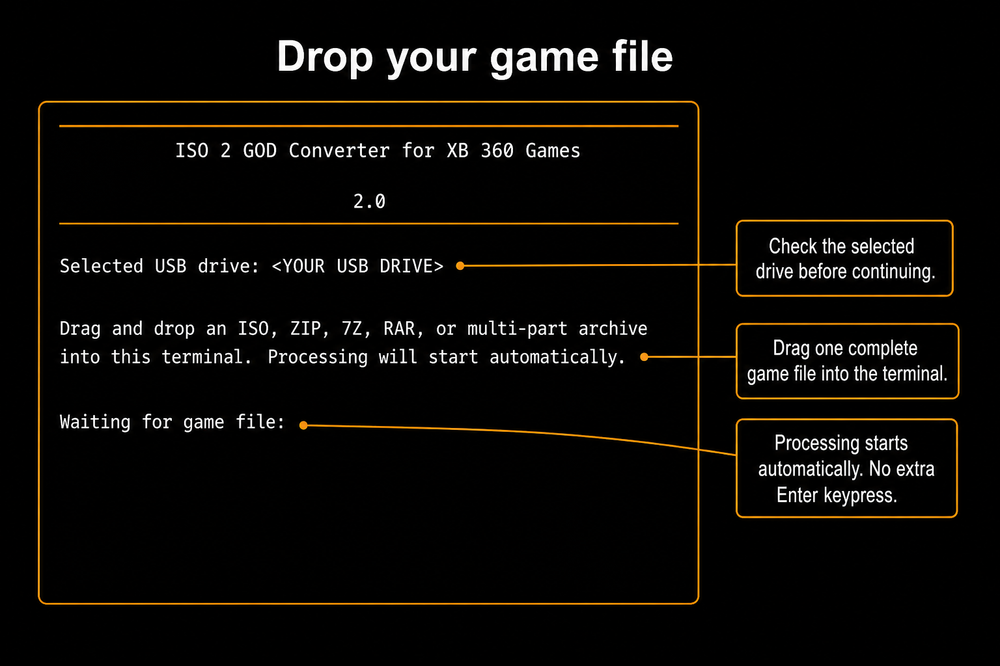
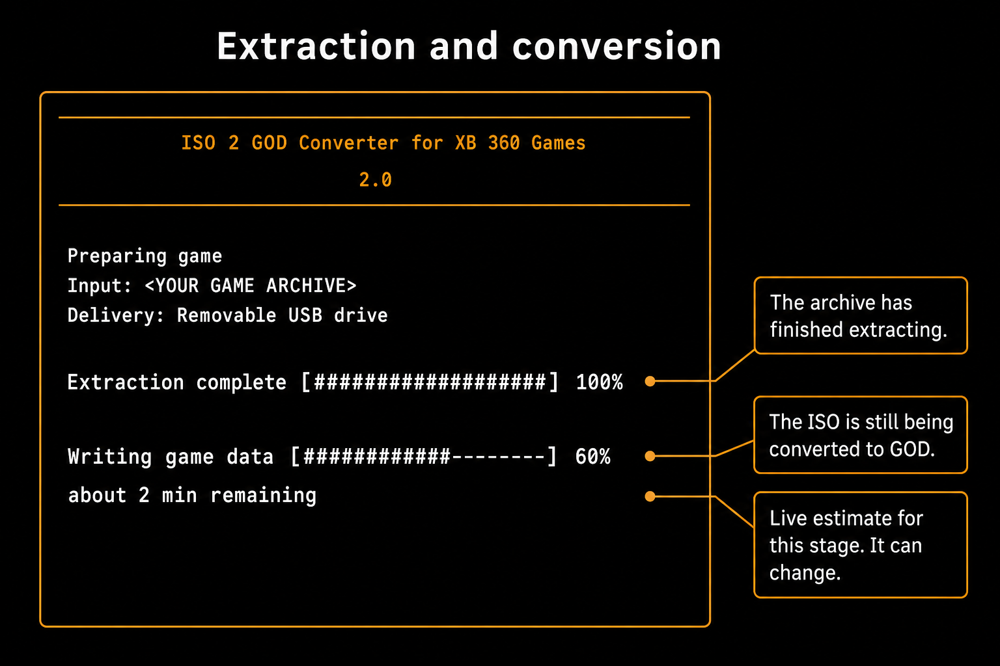
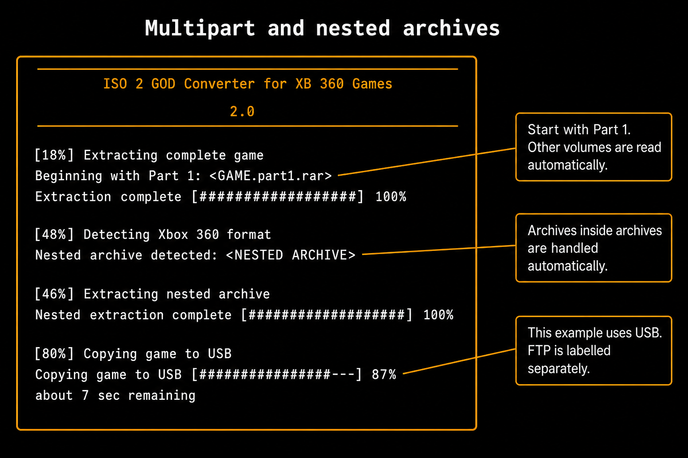

# Digital Forge

Digital Forge is a multi-console game conversion and preparation toolkit for Windows and Linux.
It brings together Xbox 360 ISO-to-GOD conversion and workflows for PlayStation, Xbox, and
Nintendo formats. The application can inspect source files, organize game and update content,
prepare supported outputs, and save supported outputs to a local folder or removable USB drive.

For PS4 FPKG conversion, supply an already fake signed base-game PKG and a matching already
fake signed update PKG. Digital Forge validates their embedded identities and merges them with
OrbisPkgTool. DLC remains separate. The PS4 workflow no longer discovers or downloads Sony
updates or decrypts retail packages; see [PS4 FPKG workflow](docs/PS4-MANUAL-FPKG.md).

Supported formats and conversion paths are listed on the [Supported formats page](site/formats.html),
along with each path's current testing status. Implemented does not mean tested; check that status
before relying on a conversion for a particular console or game.

Use game files that you own or are authorized to use. Digital Forge does not bypass copy
protection or make an incompatible output playable.

The website source is in [`site/`](site/README.md). GitHub Actions validates and publishes the
static site when website files change on the `main` branch. The optional game-reporting API is
documented in [`site-api/README.md`](site-api/README.md).

The guide below retains Xbox 360 setup and conversion instructions from the project's ISO2God
development history. Third-party attribution and notices are retained in this repository.

Download host choices are shown as listed on the source page, except 1File/1Fichier,
which is excluded by request because it requires sign-in. Other hosts are not hidden
because of an availability probe, login requirement, missing listed password or empty
folder. Download errors are reported after selection. Community reports can be used to
correct individual source links. MEGA public files and folders (including older shortened
links and multipart archives) download directly through the companion without a separate
MEGA app or account. Files are streamed to disk, decrypted and integrity-checked before
extraction. Retry reuses completed files after verifying their contents; an interrupted
file restarts. Other listed hosts may still need their own transfer implementation.

The Xbox store prefers a matching JTAG/RGH release over ISO. ISO is a fallback when no prepared
release is identified and remains supported in PC Manual Import. ZIP/RAR and multipart
prepared releases are extracted on your PC.

<details>
<summary><strong>Show guide</strong></summary>

## Downloads

Open this repository's **Releases** page and expand the release's **Assets** list. Download **one**
application matching your computer, rather than GitHub's automatically generated source-code
archives. The application downloads run directly; there is no application ZIP to extract.

| Your computer | Download |
| --- | --- |
| 64-bit Windows | `win-x64.exe` |
| 32-bit Windows | `win-x86.exe` |
| 64-bit Intel/AMD Linux | `linux-x64` |
| 32-bit Intel/AMD Linux | `linux-x86` |

Here, **x86 means 32-bit** and **x64 means 64-bit**. These releases do not include ARM builds.
macOS is currently unsupported: the maintainer does not own a Mac and cannot personally build and
test it. Community developers with Mac hardware are welcome to contribute and test a macOS version.

## User guide

Quick navigation: [USB delivery](#1-save-a-game-to-usb) · [Multipart import](#3-import-multipart-archives) · [Troubleshooting](#troubleshooting).

The walkthrough covers supported local and removable-drive workflows. The annotated images are illustrative recreations; placeholder paths and progress values are examples, not live screenshots or test results.

Have the following ready:

- Your game backup: an ISO, a supported archive, or every volume of a multipart archive.
- An Xbox configured to run the resulting game format. The converter does not modify the console
  or make an incompatible game playable.
- For USB: a mounted, writable USB drive already set up for your Xbox.
- Free space on the computer **and** the destination. Extraction and conversion can need more space
  than the compressed download. The folder containing an archive must also be writable.

Use backups you are entitled to use. If you want to retain numbered archive parts, make a backup
first: the manual archive workflow removes recognised source volumes after preparing the game and
verifying delivery. See [source-file handling](#what-happens-to-your-original-files) before importing them.

### First launch on Windows

1. Save the executable in a permanent folder of your choice.
2. Double-click it. The converter opens in a terminal window.
3. Complete any extractor prompt.
4. Choose a supported conversion workflow from the app menu.

Open the app, choose a supported conversion workflow, and follow its file and output prompts.

### First launch on Linux

Open a terminal in the downloaded application's directory and run:

```sh
chmod +x linux-x64
./linux-x64
```

For 32-bit Linux, replace `linux-x64` with `linux-x86` in both commands. Use a terminal/file-manager
combination that inserts a local path when you drag a file into the terminal.

### If an extractor prompt appears

Archives need an available extractor; multipart and nested archives require 7-Zip. If it is
missing, follow the offered installation option or open the official download page, install it,
and reopen the converter. Installation may require operating-system permission. **Archives:
7-Zip ready** means the extractor was found, not that a game has been tested.

Linux saved-password support requires an unlocked Secret Service keyring and `secret-tool`,
commonly supplied by `libsecret-tools`.

## Understand the main menu

| Choose | When to use it | What happens first |
| --- | --- | --- |
| **Manual Import** | Import an input using a supported console workflow. | Select the console and conversion path. |
| **Receive PS5 dump** | Receive a PS5 dump TAR from a compatible console workflow. | Choose where to save the received archive. |
| **Exit** | Close the PC menu. | No operation is started. |
| **Update now** | Install a deferred update. | Only shown when an update is available and deferred. |

Use **Up/Down** to move the orange selection and **Enter** to choose it. **Escape** backs out of
selection screens. Enter is still used for menus and typed setup fields; it is **not required
after dropping a valid game path** at a file-drop prompt.

AI control is separate from this menu. There is no Optional submenu and no AI screen to leave open.

## 1. Save a game to USB

**Result:** the complete prepared game is written to the USB drive you select. The Xbox does not
need to be connected to your computer over the network.

### Step 1 — Connect and select the drive

1. Connect your Xbox-compatible USB drive to the computer and wait for it to mount.
2. Open **1. Manual Import**, then **1. Import and save to a USB drive**.
3. The app displays **Searching for removable USB drives...**, followed by **Removable USB transfer**.
4. Read each listed drive's label, root/path and free space. Highlight the intended drive and press
   Enter. Do not choose a drive merely because it is first in the list.

If the list is empty, connect or mount the drive and choose **Refresh drive list**. The app lists
detected removable/USB storage, not every internal disk. It does not format a drive for you.

### Step 2 — Drop the game file

After selecting the drive, the app displays **Selected USB drive** and the file-drop instructions.



*Figure 4 — Check the selected USB drive, then drop the game when “Waiting for game file” appears.
There is no additional Enter keypress after a complete, valid path is dropped.*

1. Open the folder containing your game in your file manager.
2. Drag **one ISO, ZIP, RAR or 7Z file** into the waiting terminal.
3. Release the mouse button. Once the complete local path is recognised, preparation starts
   automatically; do not press Enter to start extraction.
4. For a split set, keep every part together and drop Part 1, or follow
   [Multipart Game Import](#3-import-multipart-archives) to drop its folder.

Do not drop a shortcut, a download-page link, or a file that is still downloading.

### Step 3 — Wait for preparation and the USB copy

An ISO is converted to GOD. An archive is extracted first, then its contents are identified.
An already-prepared GOD package or supported `default.xex` game is preserved rather than converted
again.



*Figure 5 — Extraction has finished, but ISO conversion is still running. The example estimate
applies to the current stage; the game has not yet finished copying to USB.*

Leave the drive connected until the final completion message. Archive imports also verify the USB
copy after writing it. Direct ISO-to-USB conversion checks the prepared package before copying but
does not perform that same separate destination-file verification afterward.
See [progress and completion](#read-progress-and-confirm-completion) for what each stage means.

### Step 4 — Eject only after success

Wait for the final **Complete** success message with no operation error. Safely eject the drive
through your operating system, connect it to the Xbox, and follow
[Find the game on your Xbox](#find-the-game-on-your-xbox).

Required destination folders are created automatically. **Archive-to-USB imports** refuse an
existing game directory. **Direct ISO-to-USB conversion can replace matching files** in that game's
directory. Back up an existing installation before reinstalling; do not erase the entire Content
folder. These behaviours differ in the current implementation.

## 3. Import multipart archives

**Result:** one complete game is prepared from its archive set using the selected local or USB output workflow. Use this option when you prefer to drop a folder containing the parts rather than select a single file.

### Step 1 — Finish downloading every part

Keep the original filenames and place every part of **one game directly inside the same folder**:

```text
My Game/
├── My Game.part1.rar
├── My Game.part2.rar
├── My Game.part3.rar
└── My Game.part4.rar
```

Drop the archive folder or a parent folder. The app searches every subfolder for single archives
and multipart sets. Keep each set's volumes together in the same subfolder; files from different
subfolders are not combined, even when they have the same names.

Do not rename volumes to hide gaps, combine unrelated downloads, or extract each part separately.
7-Zip must read the set beginning with its first volume.

> **Keep a backup if you want to retain the downloads.** The manual workflow permanently removes
> recognised numbered source parts only after preparing, delivering, and verifying the game.
> Read [What happens to your original files](#what-happens-to-your-original-files) below.

### Step 2 — Start the multipart import

Open **Manual Import**, select the matching console and conversion workflow, then follow its local-folder or USB destination prompts. This chooses where prepared output is written; it does not move the original archive parts.

### Step 3 — Drop the archive folder or file

Wait for **Waiting for archive or folder**. The instructions above it say:

> Drag and drop the folder, Part 1, or archive file.
>
> Processing will start automatically as soon as it is dropped.

Drag in the folder from Step 1, its Part 1 file, or a supported single archive. A direct ISO belongs
in option 1 or 2. A complete dropped path starts the import without an additional Enter keypress.

If the folder contains several recognised sets, the app asks which game to import. Use Up/Down and
Enter to choose one. The manual import does **not** automatically transfer every game in the folder;
selected multi-game batches are available through the background AI/developer interface.

### Step 4 — Let the app check and prepare the game

The importer checks numbered parts, checks storage, and opens the first volume with 7-Zip. It then
verifies the extracted output and identifies the game format. If an outer ZIP contains another
supported archive or numbered RAR set, it extracts that nested set automatically. Every nested
archive branch is searched until no supported archives remain; there is no fixed nesting-depth
limit. Each layer still requires valid archive data and enough free storage. A corrupt archive
stops the import with its path and 7-Zip diagnostic instead of silently skipping it.



*Figure 7 — Read from top to bottom: first-volume extraction, optional nested extraction, then delivery to the selected USB destination.*

| Extracted content | What the app does |
| --- | --- |
| Supported Xbox ISO | Convert it to a GOD package, then verify the prepared structure. |
| Existing GOD package | Preserve its package and data files and required Content directory structure. |
| Extracted game containing `default.xex` | Preserve the complete game folder; do not convert it to GOD. |
| No supported game found | Stop with an error instead of treating arbitrary extracted files as a playable game. |

If a numbered gap is detected, the error names the missing part. Put that exact file alongside the
other volumes and retry. A continuous sequence alone cannot prove that an unknown final volume
was downloaded: 7-Zip must also successfully read the complete archive. Keep all supplied parts,
not just enough to remove a visible numbering gap.

### Step 5 — Confirm delivery and keep the prepared copy

Wait for the selected output operation **and its verification** to finish. At **Complete**, option 3
prints **Game prepared and verified successfully at:** followed by the retained local path.
Note that path if you want the prepared copy later.

The game has already been sent to the destination selected in Step 2. You do not need to copy the
retained output again to finish this import.

### What happens to your original files

These rules apply to archive processing through supported manual import workflows.

| Item | Current behaviour |
| --- | --- |
| Direct source ISO | Left in its original location. |
| Ordinary single ZIP/RAR/7Z source | Preserved. Temporary nested extraction files are not the original archive. |
| Recognised numbered source volumes | Permanently removed only after successful extraction, preparation, and successful output verification. |
| Failure during extraction, preparation, or output | Source volumes are retained. |
| Failure during source-volume cleanup | Output has already succeeded; some source parts may remain. Note the paths in the output before closing the app. |
| Successful option 1 or 2 | Temporary prepared output is cleaned up after delivery; the destination copy remains. |
| Successful option 3 | The prepared local game is retained as well as the destination copy. |

Deletion is not a move to the Recycle Bin. After successful output and cleanup, the original
numbered parts no longer exist. Background AI jobs have a different default: they preserve source
archives unless explicitly instructed otherwise.

## Read progress and confirm completion

There are two different kinds of progress display. Orange headings such as
**[18%] Extracting complete game** are workflow checkpoints. The changing progress bar underneath
describes the current operation. They are not competing measurements of the same thing.

| Stage | What is happening | What you should do |
| --- | --- | --- |
| Scanning / detecting parts | Identify the archive set in the dropped location. | Wait, or choose one set if prompted. |
| Checking missing parts / storage | Check numbering and space available for extraction. | Resolve any named missing file or space error before retrying. |
| Extracting complete or nested archive | Unpack the archive set using 7-Zip. | Keep all source files available. |
| Verifying / detecting format | Check the extracted content and recognise a supported game. | Wait; extraction success alone is not game verification. |
| Converting / writing game data | Create GOD output from an ISO, when necessary. | Leave the app running; existing GOD or extracted games skip unnecessary conversion. |
| Preparing destination / copying / uploading | Write to the selected local folder or USB drive. | Keep the destination available while processing. |
| Verifying output | Archive imports verify the prepared output. Direct ISO-to-USB has no separate post-copy verification stage. | Do not disconnect the USB drive while verification is running, even if the copy bar reached 100%. |
| Complete | The workflow has reported success. | Eject USB safely or rescan your Xbox library. |

**Time remaining is an estimate for the current stage, not a promise for the entire job.** It appears
once the app has enough progress to estimate a rate, can rise or fall as the workload changes, and
starts over for the next stage. A short pause at a stage boundary is not automatically a failure.

Prepared-game verification checks supported structure. Output checks depend on the selected workflow; none is a byte-for-byte checksum comparison or an Xbox gameplay test. Successful output does not guarantee that a damaged source or incompatible game will launch.

## Find the game on your Xbox

After the converter reports success, your dashboard may still need to scan the destination.
Copying a game and adding it to the dashboard's library are separate steps.

### Step 1 — Make the destination available

- **USB delivery:** safely eject the drive from the computer and connect it to the Xbox. Leave it
  connected while scanning and playing.

### Step 2 — Check the game files in the dashboard's file manager

Look on the drive you actually used, rather than relying on the game's cover appearing in the library.

| Format | Path relative to the USB drive root |
| --- | --- |
| GOD | `Content/0000000000000000/<TitleID>/00007000/` |
| Extracted game | `Games/<Game Name>/default.xex` plus the rest of the game |

`<TitleID>` means the game's own title ID, not a folder literally named TitleID. The computer's
drive letter is not the Xbox's device name.

A GOD game's small package file and its matching `.data` folder belong together. Do not move only
the package file or rename the matching data folder. An extracted game also needs its accompanying
files, not just `default.xex`.

### Step 3 — Add the correct library scan location

In your dashboard's content/library settings:

1. Open the scan-path settings.
2. Add or check the exact scan location from
   [Add the scan path if the game does not appear](#step-6--add-the-scan-path-if-the-game-does-not-appear):
   `Content/0000000000000000/` for GOD games or `Games/` for extracted games, on the drive actually
   containing the files on the USB drive.
3. Set the scan depth high enough to reach the game files below the nested folders.
4. Save the path and run the dashboard's content scan.
5. Return to the game library and launch the title.

Dashboard menu labels differ; these are the required steps, not a claim that every dashboard uses
the same button names. A title-update screen manages updates, not the installed game's main files.

If the game is missing, confirm the files exist on that device before repeatedly scanning. If a
cover appears but launching is unavailable, check whether its underlying game files are present.
A cached cover is not evidence that an installation is complete.

## Background AI and developer control

AI integration is built into the executable and runs separately from the terminal interface.
There is no Optional menu and no AI screen to leave open. A compatible AI client or developer tool
starts the executable with `--mcp-server` as a background process and communicates through its
standard input/output. The terminal application does not need to be running.

This is operational control, not just a diagnostic viewer: the connected client can prepare games, run a selected batch, copy to local/USB storage, verify prepared games, install 7-Zip where supported, and check/install updates.

The app does not include an AI model. Use a client that supports local MCP tools; whether its model
is local or hosted is the client's choice. A chatbot without local tool access cannot directly
control your computer. Normal manual operation does not require any AI service.

### Connect a client

In the client's MCP server settings, use the full executable path as the command and
`--mcp-server` as the only argument. For clients using an `mcpServers` JSON configuration:

```json
{
  "mcpServers": {
    "iso2god": {
      "command": "C:/Tools/ISO2GOD/win-x64.exe",
      "args": ["--mcp-server"]
    }
  }
}
```

Replace the example path with your actual executable. On Linux, use an absolute path such as
`/home/you/ISO2GOD/linux-x64` and make it executable first. Use the x86 filename for a 32-bit build.
Configuration formats vary by client; the command and argument remain the same.

The client starts and manages this background connection. This is not an automatically installed
Windows service or Linux daemon, and it does not open a network port. It runs with the permissions
of the operating-system account that starts it.

### Ask an AI to perform a task

After adding the server, enable its tools in your AI client and ask it to check the converter's
status. A connected client should call `converter_status` and report the build and extractor
readiness. If it only gives written advice, check its MCP connection and tool permissions.

For example, you could ask:

> Inspect the games in my downloads folder. Show me the recognised games first, then prepare only
> the two I select and copy them to my selected USB drive. Preserve the source archives and report
> when each job has completed.

Give the client the actual source folder and exact destination. It can scan and inspect, ask you
to choose inputs, list USB drives, start the authorised job, and read progress until it succeeds
or fails. A batch request does not mean it should process every download without your selection.

For a problem report, ask it to inspect the affected input and explain the error before changing
anything. The bridge exposes the operations below; repairing source code requires the developer
client's own authorised editor/build tools.

### Available tools

| Tool | Purpose |
| --- | --- |
| `converter_status` | Report version, platform and extractor availability. |
| `list_usb_drives` | List detected USB roots, labels and free space so the intended destination can be selected explicitly. |
| `scan_game_folder` | Scan a supplied downloads folder recursively and return possible ISO/archive/Part 1 inputs. Scanning alone does not process them. |
| `inspect_game_input` | Inspect a supplied input and identify the archive entry point or folder contents. |
| `start_job` | Start a supported operation in a background worker and return its job ID immediately. |
| `job_status` | Report whether the job is running, completed or failed, with its structured result and recent progress output. |

### Background operations

Pass an `action` to `start_job`:

| Action | What it does and what it needs |
| --- | --- |
| `process_games` | Prepare one or several explicitly selected `sources`, then deliver them. Supports ISO files, archives, multipart sets and already-extracted GOD/`default.xex` folders. |
| `verify_game` | Check prepared GOD or `default.xex` folders supplied in `sources`. Does not run the game on an Xbox. |
| `install_archive_tool` | Install 7-Zip using the supported platform installer, or report that it is already available. |
| `check_updates` | Check the configured GitHub release source without installing anything. |
| `install_update` | Install an available release; restart the app and its AI connection afterward. |

For `process_games`, choose `destination`:

- `local`: supply an existing absolute `destination_path`; the app writes the appropriate Content
  or Games structure underneath it.
- `usb`: supply the exact root returned by `list_usb_drives`. The worker checks that it is still
  a detected USB drive and does not silently substitute a different destination.

Example `start_job` arguments for two explicitly selected downloads:

```json
{
  "action": "process_games",
  "sources": [
    "C:/Backups/Game One.iso",
    "C:/Backups/Game Two/Game Two.part1.rar"
  ],
  "destination": "local",
  "destination_path": "D:/PreparedGames",
  "remove_archive_parts": false
}
```

Use absolute paths. For a folder containing several multipart sets, scan first and supply each
selected Part 1 as a separate source. Jobs process sources sequentially and stop on the first
failure, reporting earlier completed outputs. Existing local/USB game directories are not
overwritten.

A returned job ID means **started**, not **finished**. Call `job_status` with
`{"job_id":"<returned ID>"}` until the state becomes `completed` or `failed`. Its progress tail
includes stages and available time estimates. Job IDs are scoped to the current bridge process.
Logs and results are retained in the temporary `iso2god-job-...` directory returned when the job
starts. If the client disconnects, an already-started worker may continue; reconnecting does not
restore its in-memory job registry. Do not start a duplicate transfer without checking its saved
result and destination first.

Background jobs preserve source archives by default. Set `remove_archive_parts: true` only when
the user requests deletion; recognised numbered volumes are then deleted **after successful
delivery and verification**. Single-file source archives remain intact. Failed preparation or
delivery leaves recovery files at the location recorded in the job log.

Only user-authorized inputs, destinations and operations should be passed to the bridge. The AI client may retain its own tool-call history. Do not run simultaneous
manual and AI operations against the same game or destination. Background workers reject concurrent
automation jobs rather than interleave transfers.

An installer requiring interactive elevation cannot obtain that approval through the background
worker. Complete installation locally with the required permissions and retry.

### Developer use

The bridge uses newline-delimited JSON-RPC over stdio and advertises its tool schemas through
`tools/list`. Long operations run in child processes, keeping normal progress output out of the
MCP protocol stream. This lets an editor, test harness or AI client use the same app operations.

For scripts that only need discovery, `--ai-status` prints readiness as JSON and
`--scan-folder-json <folder>` prints a batch plan. `--help` documents the existing conversion CLI.
Developers can run the automated checks from the source repository:

Install Rust first. Normal application downloads do not require Rust.

```sh
cargo test --release --locked --bin iso2god
pwsh -File scripts/build-release.ps1 -Platform WIN-X64
python tests/automation_smoke.py "../Releases/WIN-X64/digital-forge.exe"
```

`target\debug` and `target\release` are compiler intermediates, never completed application
deliverables. The deployment script writes only to the established directories
`../Releases/WIN-X64`, `../Releases/WIN-X86`, `../Releases/LINUX-X64`, and
`../Releases/LINUX-X86`. Select the matching platform when deploying a release; do not rename a
binary from another target. Install 7-Zip to include archive smoke tests. The smoke test uses synthetic files, not your games or Xbox.

Application control does not grant an AI arbitrary shell access or a source-code editor. A developer
AI can modify and rebuild the project through its own authorized development tools; the bridge
exposes the implemented converter operations rather than an unrestricted command-execution endpoint.

## 4. Update now

Release builds use the existing `self_update` library to check their configured GitHub repository
for a newer release at startup. You do not need to install a separate updater.

1. Open the converter. If a newer version is found, **Update available** replaces the normal menu
   and shows the current and available versions.
2. Choose **Yes** to download and install the matching platform release, or **No** to continue
   using the current version.
3. If you choose No, **3. Update now** appears directly on the main menu for that session. Select
   it later when you are ready to update; it is not inside Optional or another submenu.
4. Wait for the installation-success message. Close and reopen the converter to use the new
   executable. Restart a connected AI client's converter bridge as well.

There is no permanent fourth item when no update is waiting. Checks happen at startup, not during
an active transfer. Do not start an update while another converter process is using the executable.
If installation fails, check the reported error, network access and write permission to the
application folder before retrying.

Builds without a configured release repository do not check automatically. Download the correct
newer executable from Releases manually after closing the app. Keep game files separate from the
application download.

## Troubleshooting

- **No USB drive detected:** connect and mount it, then choose **Refresh drive list**. The menu
  lists detected removable/USB storage, not every internal disk.
- **Dropped path does not start:** wait for the file-drop prompt and check that the file exists.
  Your terminal must insert a local path when you drop it. For multipart imports, drop the folder
  or Part 1 with all remaining volumes alongside it.
- **Missing numbered part:** put the named missing volume beside the other parts and retry.
- **Archive header or data error:** this is not automatically a missing numbered part. The archive
  may be damaged or incompletely downloaded even when all filenames are present. The app displays
  7-Zip's diagnostic and preserves the originals. Test the archive in 7-Zip and obtain a complete,
  valid copy before retrying; deeper folder searching cannot repair corrupt archive data.
- **Not a recognised game:** the contents must include a supported ISO, valid GOD package, or
  extracted game with `default.xex`; an archive extension alone is not enough.
- **Destination already contains this game:** archive-to-USB delivery refuses an existing game
  directory. Direct ISO-to-USB can replace matching files. Back up the specific installation
  before reinstalling; do not delete unrelated titles, saves or the whole Content directory.
- **Time remaining changes:** estimates are calculated during processing and can rise or fall.
  Extraction, conversion, and copying are separate stages. Wait for the final success message;
  reaching 100% on a progress bar may still be followed by verification.
- **Transfer finished but game will not launch:** check the complete output structure, scan path,
  source game and console compatibility. See the verification limits above; completion is not a
  gameplay test. A cover can remain even when its underlying game files are missing.
- **Folder import finds no parts:** drop the folder directly containing the numbered volumes.
  Dropping an ordinary single ZIP/RAR/7Z file is supported, but scanning its parent folder is not
  the same as selecting that file.
- **Source archives disappeared:** recognised numbered volumes are removed after preparation in
  manual workflows. Look for the retained prepared game and read the source-file handling table
  before attempting a retry. An ordinary single source archive is preserved.

## Credits

This project preserves the work and attribution of every contributor in its original project
history.

| Contributor | Project contribution |
| --- | --- |
| [Elie Charra (`eliecharra`)](https://github.com/eliecharra) | Original author of [`iso2god-cli`](https://github.com/eliecharra/iso2god-cli) |
| [Ilia Pozdnyakov (`iliazeus`)](https://github.com/iliazeus) | Creator and primary developer of the optimized `iso2god-rs` rewrite |
| [BUD M4N (`rileyadams05`)](https://github.com/rileyadams05) | Developer and maintainer of this continuation |
| [`astarivi`](https://github.com/astarivi) | `iso2god-rs` contributor |
| [`TonyMacDonald1995`](https://github.com/TonyMacDonald1995) | `iso2god-rs` contributor |
| [`blank-query`](https://github.com/blank-query) | `iso2god-rs` contributor |
| [`cocciasecca`](https://github.com/cocciasecca) | `iso2god-rs` contributor |

Thank you to every contributor for the foundation on which this continuation is built.

## License

Distributed under the [MIT License](LICENSE). The original copyright and permission notice remain
intact. Notices for bundled third-party components are provided in
[THIRD-PARTY-NOTICES.txt](THIRD-PARTY-NOTICES.txt).

</details>
